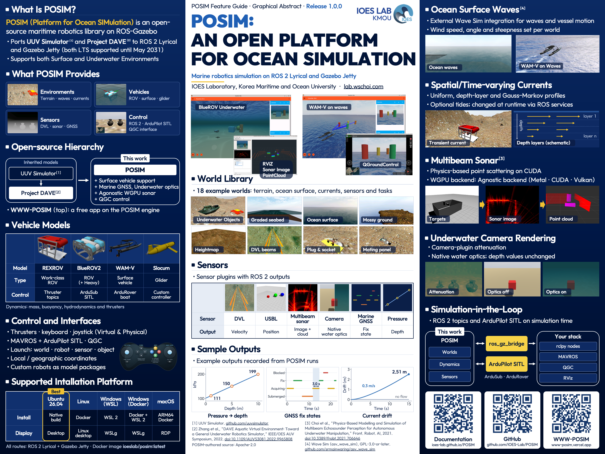

# POSIM — Platform for Ocean Simulation

[English](README.md) · [Español](README.es.md) · [Français](README.fr.md) · [Deutsch](README.de.md) · [Italiano](README.it.md) · [한국어](README.ko.md) · [日本語](README.ja.md) · [中文](README.zh.md)

[](https://github.com/IOES-Lab/POSIM/actions/workflows/docker-amd64.yml)

POSIM est une bibliothèque open source de simulation en robotique marine. L’[IOES Lab. de la Korea Maritime & Ocean University (KMOU)](https://lab.wschoi.com) en assure la maintenance.
Elle réunit des environnements océaniques, des robots sous-marins et de surface, des capteurs simulés et des interfaces de commande ROS 2 pour Gazebo Sim.



## Documentation et premiers pas

**[Lire la documentation en français](https://ioes-lab.github.io/POSIM/fr/)**

[Historique des versions](CHANGELOG.md)

POSIM utilise ROS 2 Lyrical et Gazebo Sim Jetty. Choisissez une méthode d’installation adaptée à votre système :

- **Ubuntu 26.04 :** l’[installation native](https://ioes-lab.github.io/POSIM/fr/install.html) est recommandée. Sous Linux, vous pouvez aussi utiliser l’[installation avec Docker](https://ioes-lab.github.io/POSIM/fr/install-ubuntu-docker.html).
- **Windows :** [WSL](https://ioes-lab.github.io/POSIM/fr/install-windows.html) ou [WSL + Docker](https://ioes-lab.github.io/POSIM/fr/install-windows-docker.html).
- **macOS :** [Docker + RDP](https://ioes-lab.github.io/POSIM/fr/install-macos.html).

Comparez les possibilités dans [Choisir un environnement](https://ioes-lab.github.io/POSIM/fr/requirements.html),
[préparez vos terminaux](https://ioes-lab.github.io/POSIM/fr/terminals.html),
puis lancez votre [première simulation](https://ioes-lab.github.io/POSIM/fr/quickstart.html).

Le [catalogue des fonctionnalités et exemples](https://ioes-lab.github.io/POSIM/fr/features.html) renvoie aux guides des robots,
des mondes, des capteurs et de leur commande. Vous y trouverez aussi les
[effets sous-marins et la neige marine](https://ioes-lab.github.io/POSIM/fr/underwater-rendering.html)
ainsi que le [GNSS en milieu marin](https://ioes-lab.github.io/POSIM/fr/gnss.html).

## Images Docker

Téléchargez l’image actuelle :

```bash
docker pull ioeslab/posim:latest
```

Docker sélectionne la variante AMD64 ou ARM64 adaptée à votre machine. Pour reproduire une expérience avec la même version,
choisissez sur [Docker Hub](https://hub.docker.com/r/ioeslab/posim/tags) une étiquette `sha-<12-character-commit>`,
qui reprend les 12 premiers caractères de l’identifiant du commit.
Avant de créer le conteneur, suivez [Choisir un environnement](https://ioes-lab.github.io/POSIM/fr/requirements.html)
pour configurer l’affichage sous Linux, Windows WSL ou macOS.

## Application associée

[WWW-POSIM](https://www-posim.vercel.app/) associe POSIM à des bibliothèques de terrain géographique, de planification de trajets
et de commande de véhicules, puis y ajoute une interface graphique et des applications web et de bureau.
Sa documentation décrit l’utilisation de ces applications.

## Contribuer

Vous pouvez signaler un problème ou proposer une modification dans [IOES-Lab/POSIM](https://github.com/IOES-Lab/POSIM).
Le [guide de contribution](https://ioes-lab.github.io/POSIM/fr/contributing.html) présente les vérifications à effectuer
pendant le développement et la mise à jour de la documentation.

## Licence et attribution

POSIM contient du code de [Project DAVE](https://github.com/Field-Robotics-Lab/dave) et conserve ses mentions d’auteur et de copyright.
Le code développé pour POSIM est distribué sous [licence Apache 2.0](LICENSE).
Le code et les ressources de tiers restent soumis à leurs conditions d’origine.
La dépendance externe Wave Sim est compilée depuis son dépôt amont sous les conditions de la GPL ;
consultez les [informations sur cette dépendance et sa distribution](extras/surface/README.md#licensing).
