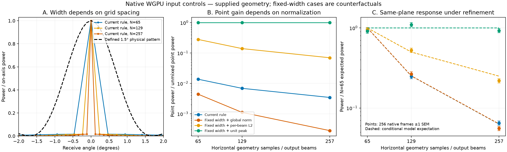

# 빔 응답과 각도 셀 적분 대조

[English](README.md)

거리 면적식 수정이 포함된 통합 `00280573`의 실제 WGPU에 기하 입력을
제공했습니다. 장면과 각도 시야는 유지하고 수평 샘플을 65·129·257개로
바꿨습니다. 현재 ABI에서는 출력 수와 입력 수가 여전히 같으므로 세 격자에
공통으로 존재하는 수신 방향을 비교합니다. 새 렌더링 설정이나 현장 실험은
아닙니다.



현재 보정 행렬은 원본 C++ 메서드를 그대로 추출·컴파일해 계산했습니다.
격자가 촘촘해질수록 모델의 전력 반치폭이 0.4698°·0.2349°·0.1174°로
좁아집니다. 비교 모델의 1.5° 반치폭은 **정의한 합성 대조값**이며, Sonoptix의
실측 응답이나 카탈로그 각분해능을 반치폭으로 해석한 값이 아닙니다.

같은 점의 중앙 출력 전력을 혼합 전 native 반사 전력으로 나누면 현재의
전체 행렬 정규화에서 0.01373·0.006890·0.003451입니다. 물리적 빔 폭을 고정해도
전체 행렬 정규화는 이득을 바꿉니다. 수신 빔별 L2 정규화도 이 문제를
해결하지 않습니다. 중앙 방향의 물리적 이득을 1로 둔 대조에서 점의 이득이
유지됩니다. 부호가 있는 sinc와 절댓값 sinc를 모두 보존했습니다. 점 전력은
같지만 부호가 있는 sinc에서는 부엽의 위상 반전이 유지됩니다.

같은 전방 평면을 조건별 256프레임 계산한 현재 모델의 평균 전력은
765.22·200.42·52.51입니다. 조건부 기대값은 809.98·203.64·51.04입니다.
빔 폭과 중앙 이득을 고정한 대조의 기대값은 가장 성긴 격자와 조밀한 격자
사이에서 0.00464%만 달라집니다. 그림에는 실제 난수 변동도 그대로 남겼습니다.
오차 막대는 Monte Carlo 평균의 표준오차 한 배이며, 실기 오차나 지도
불확실성이 아닙니다. 출력 빔 평균 2,255개가 사전 선언한 가우스 모멘트
한계 안에 있습니다. 이는 조건부 계산의 확인이며 물리 센서의 보정이 아닙니다.

현재 합산 항은 면적 가중치가 이미 분산에 들어간 **각도 셀의 반사 기여분**입니다.
[Choi 등(2021)의 2.4절](https://kerednoslo.github.io/papers/Choi2021.pdf)에 있는
수신 빔별 L2 정규화는 이미 형성된 이상적 빔 신호를 혼합하면서 평균 제곱값을
보존합니다. 현재의 전체 행렬 정규화를 그 식으로 바꾸는 것만으로는 샘플 수에
독립적인 표면 적분이 되지 않습니다.

별도의 실제 C++ 백엔드 42회 대조에서 수직 행 7개를 각각 넣고 간격 1·2·3을
확인했습니다. WGPU는 해당 간격으로 나뉘는 행만 선택하고 CPU는 모든 행을
사용합니다. 두 구현은 셀 면적에 `간격 + 1`을 곱합니다. 따라서 남는 반사의
전력은 간격 1 대비 1·1.5·2배입니다. 이 선택·가중치 계약의 불일치는 끝점 셀을
포함한 공통 적분 모델에서 해결해야 합니다. CUDA의 행 선택은 이 장비에서
실행하지 않았습니다.

다음 구현은 기하 샘플 좌표와 셀 가중치, 물리적인 빔 응답·이득, 출력 빔의
중앙 좌표를 분리해야 합니다. 표시 이득 보정, 정규화 하나의 교체, SLAM 점군
보간으로 대신하지 않습니다. 기하 샘플에서 수신 빔으로 연결하는 직사각 행렬과
공통 샘플링 계약을 먼저 적용한 뒤 새 현장 자료를 수집합니다. 입사각 법칙과
시간에 따른 산란의 일관성은 별도 검증으로 남습니다.

Apple M3 Pro/Metal에서 빔 대조 3,876회는 23.33초 걸렸습니다. 원본 14.1 MB에는
모든 점 반사 복소 출력, 모든 평면 출력 빔의 프레임별 전력, 사전 지정한 복소
채널과 평면의 처음·마지막 전체 프레임을 보존했습니다. 이 간결한 사본에는
모든 점 전달 응답과 전체 거리 기준 신호, 모든 빔 평균·표준오차, 사전 지정한
세 방향의 모든 프레임 전력이 들어 있습니다. 점 전달 응답으로 원본 출력을
복구할 때 최대 상대 오차는 `1.52e-7`입니다. 원본 해시와 정확한 소스·바이너리
식별자는 `result.json`에 있습니다.

Python과 NumPy로 독립적인 수치 검사를 실행합니다.

```sh
python verify_record.py
```

이 기록은 현재 물리 모델 계약의 실패를 보고합니다. 대체 모델 설치, 소나 지도
수용 또는 연구 독창성을 주장하지 않습니다. 전체 BlueROV/SLAM·실행 환경·VRX·
이후 해저 측량의 완료 조건은 유지합니다.
