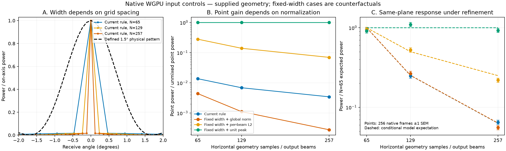

# Aperture and angular quadrature control

[한국어](README.ko.md)

The supplied-geometry WGPU experiment uses integration `00280573`, including
the projected-area correction. It keeps the scene and the angular field fixed,
then compares 65, 129 and 257 horizontal samples. Output counts are still tied
to input counts by the current ABI; receive directions shared by all three
grids are compared. This is not a newly configured renderer or a field trial.



The current corrector is compiled directly from its source method. Its modeled
power FWHM changes from 0.4698° to 0.2349° and 0.1174° as the grid is refined.
The alternative 1.5° FWHM is a **defined synthetic control**, not a measured
Sonoptix response or an interpretation of catalogue angular resolution.

The same point has on-axis power relative to its unmixed native return of
0.01373, 0.006890 and 0.003451 under the current global normalization. With a
fixed physical pattern, global normalization still changes that point gain;
per-receive-beam L2 normalization also changes it. Unit on-axis physical gain
preserves it. All signed and absolute-pattern controls remain in the record.
Their point powers agree, but the signed sinc retains side-lobe phase reversals.

For the diffuse front plane, 256 frames per case produce current-model mean
power 765.22, 200.42 and 52.51. The corresponding conditional expectations are
809.98, 203.64 and 51.04. Fixed-width/unit-peak expected power changes by only
0.00464% between the coarsest and finest grids. The figure retains native
fluctuations; its error bars are one Monte Carlo standard error. They do not
measure hardware or mapping uncertainty. All 2,255 output-beam means satisfy
the predeclared Gaussian moment bound. That check supports the conditional
calculation, not physical-sensor calibration.

The distinction matters: current summands are **angular-cell contributions**,
whose variance already includes their represented area. The per-beam L2
normalization in [Choi et al. (2021), section 2.4](https://kerednoslo.github.io/papers/Choi2021.pdf)
mixes already formed ideal-beam signals to preserve their mean-square value.
Substituting that normalization for the current global one does not by itself
produce quadrature-invariant surface integration.

A separate 42-call production C++ control checks every elevation row at strides
1, 2 and 3. WGPU selects rows divisible by the stride; CPU uses every row.
Both scale the cell area by `stride + 1`. The resulting nonzero powers scale
by 1, 1.5 and 2 relative to stride 1. This inconsistent selection/weight contract
must be addressed with the quadrature model, including endpoint cells.
CUDA selection is not executed on this host.

The implementation consequence is to separate geometry sample coordinates and
cell weights, calibrated physical beam response/gain, and output beam centers.
Do not patch a display gain, simply replace one matrix norm, or interpolate a
SLAM cloud. A rectangular geometry-to-receiver operator and a shared sampling
contract must precede replacement field data. The incidence-law and temporal
scattering questions remain open.

The 3,876 aperture calls take 23.33 s on the measured Apple M3 Pro/Metal host.
The canonical 14.1 MB raw record retains every point complex output, every
diffuse output-beam energy, all predeclared selected complex channels, and the
first/last complete diffuse frames. This compact copy retains all point
transfer profiles and their full range baselines, every beam mean/standard
error, and every frame's energy in the three predeclared directions. Point
profiles reconstruct the raw outputs with relative error at most `1.52e-7`.
The raw-record hash and exact source/binary identities are in `result.json`.

Run the portable numerical check with Python and NumPy:

```sh
python verify_record.py
```

The record reports failures of the current physical contract; it does not
install a replacement model, accept a sonar map, or claim a research novelty.
The full BlueROV/SLAM, runtime, VRX and later seabed-survey gates remain open.
