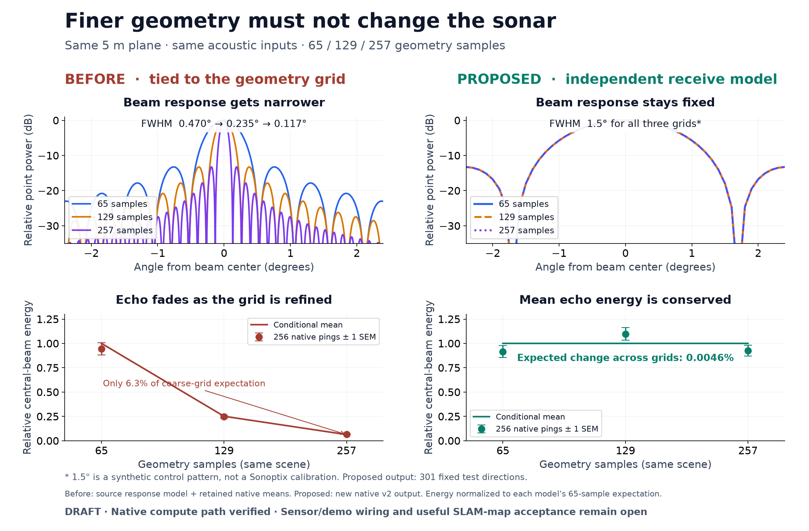
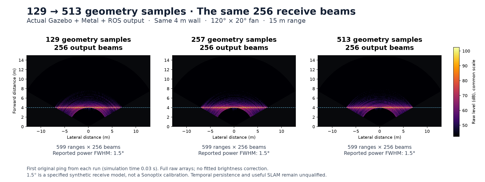

# 기하 샘플링과 분리한 물리적 수신 계산

[English](README.md)

선택적으로 사용하는 native `AcousticReadout` / `sonar_wgpu_compute_v2` 경로에
기하 열 수, 선택한 고각 행, 각 샘플이 대표하는 입체각을 정의했습니다.
출력 수신 방향, 부호를 보존하는 음압 응답, 수신 이득은 별도로 지정합니다.
수직 간격이 행 수와 나누어떨어지지 않아도 끝점 셀이 전체 각도 영역을
포함합니다. 면적을 반사율에 섞지 않으며, 직사각형 행렬의 입력·출력 크기를
버퍼와 캐시 키 전체에서 구분합니다.

새 CPU 경로도 주파수별 위상 합산, 수신 응답 가중, 원래 길이의 순방향 DFT를
수행합니다. WGPU와 같은 투영 면적·입사각 코사인 제곱의 전력 법칙과 카운터
기반 무작위 산란을 사용합니다. 기존 CPU 근사 경로는 별도 legacy 모델로
유지합니다. CUDA는 이 새 입력을 명시적으로 거부합니다.

PR6 소유 소스에는 기존 정수 고정소수점·radix-2 계산이 남아 있어 v2에서
2의 거듭제곱이 아닌 길이를 거부합니다. 별도 통합 소스는 후속 PR의 부동소수점·
정확한 길이 변환을 유지합니다. 후속 PR을 PR6에 병합하지 않았습니다.
부분 타일의 입력 경계를 독립적으로 검사하는 기존 수정 원칙도 직사각형에
확장했습니다. 통합 소스의 셰이더 직접 테스트에는 출력 수 uniform을 추가했습니다.

## 실제 native 검증

- 소유 CPU 64개, 소유 Metal 16개 radix-2 조합이 통과했습니다.
  CPU 대비 최대 복소 신호 상대 차이는 `1.9983e-5`입니다.
- 통합 Metal은 63·64·65·599 길이, 기하 열 5·17개와 출력 1·3·19개를
  포함한 64개 조합을 통과했습니다. 최대 상대 차이는 `2.5344e-6`이며,
  미리 정한 한계는 `3e-4`입니다.
- 두 소스 계열 모두 끝점·수직 간격·무반사 NaN·영 주파수 창·수신 이득·
  잘못된 입력과 기존 CPU·Metal 거리 대조를 통과했습니다.
- 통합 Rust 단위 검사, Metal 행렬 검사 2개, 창·입력 검사 3개와 새 CMake/
  CTest CPU 대상도 통과했습니다.

별도 2,307회 native 대조는 출력 9개를 고정하고 기하 열을 65·129·257개,
고각 간격을 1·2·4로 바꿨습니다. 매끄러운 평면의 조건부 평균 에너지 예측은
아홉 격자 전체에서 최대 **0.4823%** 변해 사전에 정한 1% 수렴 기준을
충족했습니다. 256프레임의 실제 평균은 각 조건부 기대값과 최대 **11.734%**
차이가 났습니다. 모두 가우스 이차형식에 대해 미리 정한 보수적 통계 범위
`[-25.054%, +30.098%]` 안에 있습니다. 81개 비교 전체의 오류 확률 상한은
조건부 모델에서 1%입니다. **0.4823%는 실기 오차 주장이 아닙니다.** 실제
변동을 별도 이득으로 보정하지 않고 보존했습니다.

세 단일 표면 조각 대조의 부호 있는 복소 응답 오차는 최대 `3.85e-8`입니다.
여기서 전력 반치폭 **0.08 rad**는 정의한 합성 패턴이며 Sonoptix 실측값이나
카탈로그 분해능을 변환한 값이 아닙니다.

`arrays.npz`는 모든 프레임·수신 방향의 평면 에너지, 단일 표면 조각 출력
세 개 전체, 평면의 첫·마지막 전체 복소 출력을 보존합니다. C++ 전체 비교,
빌드·명령 로그·소스 스냅샷은 2026-11-01 근본 검토의 `physical-readout/`에
한 번만 보존합니다. `source-receipts.json`에 소스·바이너리·원본 해시가 있고,
`result.json`의 native 함수 주소는 격리된 실제 바이너리로 확인했습니다.

NumPy가 있는 Python으로 `python verify_record.py`를 실행하면 보존 자료와
조건부 에너지·점 응답을 독립적으로 확인합니다. 센서를 실행하는 검사는 아닙니다.

## 실제 센서 경로 연결

SDF 설정, 고정된 기하·수신 방향, 렌더링 프레임 스냅샷, v2 계산과 ROS·부채꼴
영상 출력을 연결했습니다. `ray/scan/horizontal`의 `samples`는 기하 열 수,
`beams`는 출력 수신 빔 수입니다. `spec`의 양수 `receiveBeamWidth`는 부호 있는
sinc 모델을 선택하며, `ray degrees`와 관계없이 **라디안 단위 전력 반치폭
전체 너비**입니다. `receiveGain`은 선형 음압 이득이며 기본값은 1입니다.
폭이 없거나 0이면 명시적으로 표시되는 기존 모델을 유지합니다. 기하 열 수를
출력 빔 수와 다르게 설정하려면 양수 수신 폭이 필요합니다.

실제 Gazebo·Metal 통합 실행에서 기하 열 수 129·257·513에 관계없이
**256개 수신 빔과 599개 거리 샘플**을 확인했습니다. 수직 샘플은 256개,
범위는 15 m입니다. 기하 해상도 세 가지, 기존 설정, 수신 이득 0의 다섯 대조에서
각각 시간표시가 일치하는 소나 원본·법선·XYZ·영상 묶음을 네 개 이상 보존했습니다.
이득 0에서는 벽의 기하 정보가 남고 소나 반향은 0, 영상은 검정입니다.
실행한 서버·브리지 열 개 모두 강제 종료 없이 정상 종료했습니다.
1.5°는 정의한 합성 패턴이며 Sonoptix 실측 교정값이 아닙니다.

첫 수신기의 DDS 도메인 235는 UDP 포트 범위를 초과했습니다. 확인된 도메인
222로 돌아간 뒤에도 best-effort 방식의 513열 수신기는 원본 71개를 받았지만
기하·법선 메시지를 받지 못해 기존 40초 기준에 실패했습니다. 이미 reliable로
발행하는 발행기에 **reliable 수신을 요청**하자 **센서 바이너리·주기·제한 시간을
바꾸지 않고** 통과했습니다. 실패 기록을 함께 보존합니다. 이는 수신기의 전송
조건을 확인한 결과이며 센서 정확도나 SLAM 개선의 증거는 아닙니다.

백엔드는 실제 물리 모델의 크기와 변환 길이로 선택합니다. PR6 계열 WGPU는
홀수 길이를 거부하고 auto는 물리 CPU를 선택합니다. 별도 #34 통합은 정확한
길이를 지원합니다. 명시적 CUDA 물리 모델 선택은 실패합니다. 선택·잘못된 입력
대조와 기존 CPU·Metal 비교를 통과했고, 시간 로그에서 기하 열과 출력 수신 빔을
구분합니다.

`wiring/summary.json`에 결과와 원본 해시를 기록했습니다. `wiring/data.npz`에는
각 대조의 첫 소나 원본과 동기화한 소나·영상·XYZ 묶음 하나씩을 담았습니다.
전체 수신 기록은 원본 위치에 한 번만 보존합니다. `python wiring/verify.py`로
배열·SDF·메타데이터를 확인하고, `python wiring/render.py`로 공통 밝기·미터
좌표 비교를 다시 그릴 수 있습니다.

## 남은 작업

센서 소스 경로는 연결하고 실행했습니다. 앱 데모 설정과 검증된 공급 번들은
아직 전환하지 않았으며 설치 SDK·LIVE·runner도 그대로입니다. 문서 첫 그림은
앞선 native 계산 단계, 위의 추가 그림은 전체 센서 경로의 기록입니다.

거리·펄스 지원과 순환 거리 겹침 방지, 복수 표적·가림, 고정·이동 시점의 시간적
산란을 먼저 확인합니다. 이후 검증된 데모 설정을 활성화하고 현장 기록 하나를
새로 수집해 미사용 시점의 관측 지지를 평가한 뒤 native SLAM에 연결합니다.
CUDA·설치 런타임 검증도 남았습니다. 알려진 수치·음향 모델 구현이며 유용한
소나 지도나 연구 독창성의 입증은 아닙니다. 전체 BlueROV·SLAM·제품·VRX 및
이후 WAM-V 측량 목표는 계속 진행합니다.
