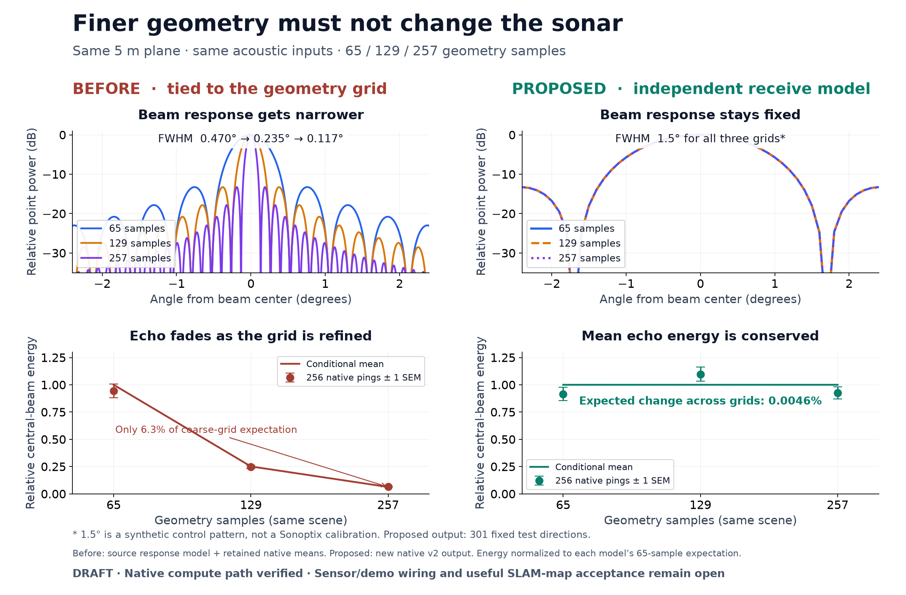
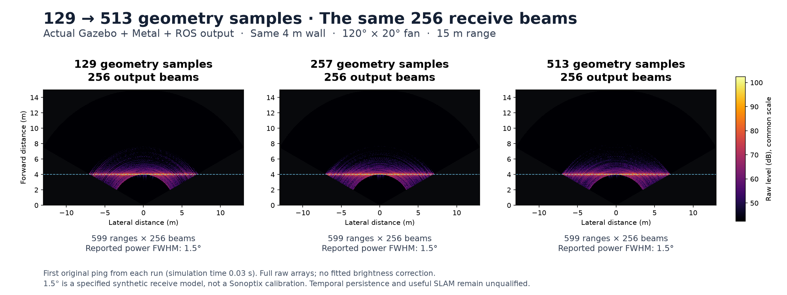
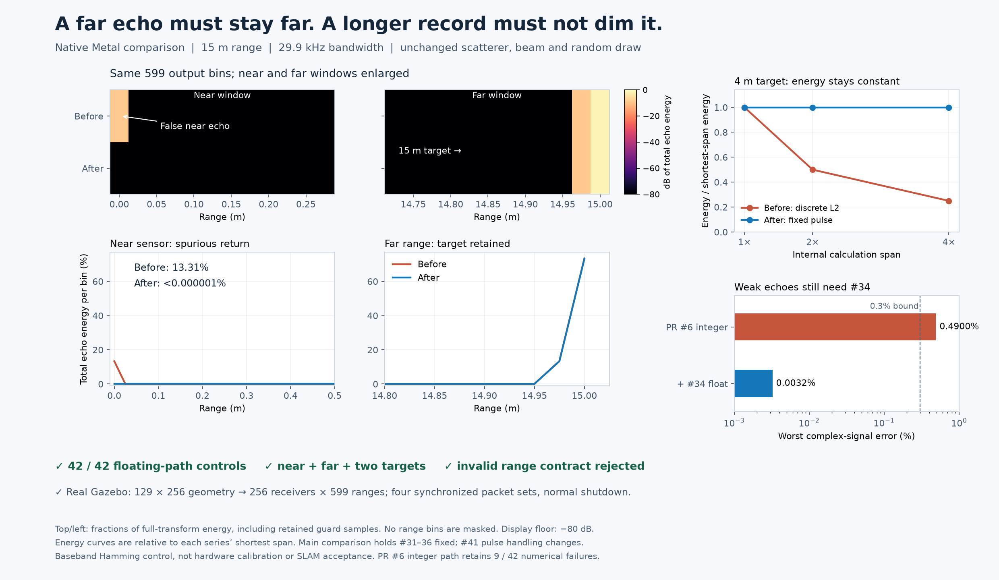

# Physical readout independent of geometry sampling

[한국어](README.ko.md)

The opt-in native `AcousticReadout` / `sonar_wgpu_compute_v2` path separates
geometry columns, selected elevation rows and represented solid angles from
output receiver directions, signed pressure response and receive gain.
Endpoint cells cover the complete angular domain even when the elevation
stride does not divide the row count. Reflectivity does not hide cell area.
The rectangular operator owns its input/output buffer sizes and cache key.

CPU physical mode now performs the frequency-domain phase sum, physical
receive weighting and original-length forward DFT. It uses the same declared
projected-area / cosine-squared power convention and counter-based random
scattering as WGPU. The old CPU fallback is retained as a different legacy
model. CUDA explicitly rejects this new readout instead of using square
buffers with the wrong interpretation.

The PR6 owning source retains its fixed-point/radix-2 implementation and
rejects non-power-of-two lengths in v2. The separate integration retains the
follow-up floating-point/exact-length transform fixes. No follow-up PR was
merged into PR6. The extended matrix input bounds also apply the existing
partial-tile correctness rule to rectangular inputs. The integration's
direct shader test supplies the new trailing output-count uniform.

## Actual native evidence

- Owning CPU: 64 rectangular cases; owning Metal: 16 radix-2 cases, maximum
  relative complex-signal difference from CPU `1.9983e-5`.
- Integrated Metal: 64 cases, including lengths 63, 64, 65 and 599, with
  5/17 geometry columns and 1/3/19 receiver rows. Maximum relative complex
  difference from CPU is `2.5344e-6`; the declared bound is `3e-4`.
- Both lineages pass endpoint/stride, no-return NaN, zero-window, receive-gain
  and invalid-input controls, plus the existing CPU/Metal range regressions.
- The integration passes its Rust unit tests, two explicit Metal matrix tests,
  three explicit Metal window/input tests, and the new CMake/CTest CPU target.

A second 2,307-call native control holds nine receiver directions fixed while
changing geometry columns 65/129/257 and elevation strides 1/2/4. The smooth
plane's conditional mean-energy prediction changes by at most **0.4823%**
across all nine quadratures, below the predeclared 1% convergence bound.
Actual 256-frame means differ from their respective conditional expectations
by at most **11.734%**. Every mean lies within the predeclared conservative
Gaussian-quadratic-form family bound, `[-25.054%, +30.098%]`, for 81 comparisons
at family error bound 1%. This is statistical consistency, not a 0.4823%
hardware-error claim. Native fluctuations are retained without rescaling.

Three single-patch controls preserve the signed receive response while
geometry density changes; maximum complex response error is `3.85e-8`.
This test's power FWHM is **0.08 radians**, a specified synthetic pattern,
not a Sonoptix measurement or a reinterpretation of catalogue resolution.

`arrays.npz` retains every plane energy from every frame/receiver, all three
complete point returns, and the first/last complete plane returns. Canonical
raw C++ comparisons, builds, command logs and source snapshots remain once
at `physical-readout/` beneath the 2026-11-01 fundamental review. Their hashes,
exact source files and binary identities are in `source-receipts.json`.
The native function address resolves to the isolated binary in `result.json`.

Run `python verify_record.py` with NumPy to independently check the portable
data, conditional energy and point response. This does not execute a sensor.

## Actual sensor wiring

The sensor now connects SDF, immutable geometry/receiver angles, render-frame
snapshots, the v2 compute path and outgoing ROS/fan directions. In
`ray/scan/horizontal`, `samples` sets geometry columns and `beams` sets output
receivers. In `spec`, positive `receiveBeamWidth` selects the signed-sinc model
and is the **full power FWHM in radians**, regardless of `ray degrees`;
`receiveGain` is linear pressure gain (default 1). Missing/zero width retains
the reported legacy model; independent geometry counts require positive width.

The actual Gazebo/Metal integration keeps **256 receivers and 599 range bins**
for 129/257/513 geometry columns, all with 256 elevation samples and a 15 m
range. Five sensor controls retain at least four timestamp-matched raw,
normal, XYZ and preview sets each: three geometry densities, an unchanged
legacy configuration, and zero receive gain. Zero gain leaves the physical
wall geometry intact while publishing zero return and a black preview.
All ten owned server/bridge processes exit normally without escalation.
The 1.5-degree response is a declared synthetic model, not a Sonoptix calibration.

The recorder's first domain choice (235) exceeded the DDS UDP port range.
After returning to qualified domain 222, the best-effort 513-column observer
received 71 raw pings but no geometry/normal packets and failed its original
40-second bound. Requesting **reliable** QoS from the already reliable publishers
passes with the **same sensor binary, rates and deadline**. Preserve both failures;
this diagnoses the observer's delivery contract, not a sensor or SLAM improvement.

Backend selection now probes the real physical shape and transform length.
Owning PR6 WGPU rejects odd lengths and auto selects physical CPU; the separate
#34 integration accepts exact lengths. Explicit CUDA physical selection fails.
Native selection/malformed-input controls and the prior CPU/Metal comparisons
pass. Timing logs distinguish geometry columns from output receivers.

`wiring/summary.json` records all control outcomes and original capture hashes.
`wiring/data.npz` includes the first raw ping and one synchronized sonar/image/XYZ
set per case; complete original captures remain once in the canonical record.
Run `python wiring/verify.py` to independently check arrays, SDF and metadata;
`python wiring/render.py` redraws the shared-scale metric comparison.

## Physical pulse and range support

The physical path samples a unit-peak baseband Hamming pulse with fixed bandwidth.
It keeps the output grid `dr = c/(2B)` separate from frequency quadrature. At 15 m,
1500 m/s and 29.9 kHz it publishes 599 ranges and calculates 2048 midpoint
frequency samples. The internal period is at least twice the output interval.
`B*S(f)` is integrated with `1/M` after accumulation; the midpoint origin is
removed from the complex result. This preserves pressure when the calculation
length changes and avoids putting the far pulse's periodic copy near zero.
The output remains the complete configured range interval; diagnostics retain
the full internal transform, including the guard. Physical sidelobes remain.

The pre-change 15 m point puts **13.313%** of its full-transform energy below
0.5 m. With the floating integration, that fraction is below **0.000001%**.
Doubling calculation length previously halved the 4 m target's energy; the
fixed pulse changes full-transform energy by less than **0.00003%** in this
control. This is a numerical invariant, not a sonar hardware accuracy claim.

Independent Philox amplitudes, the continuous Hamming impulse and the discrete
midpoint transform check 42 near/far/two-target cases at source levels 180 and
220 dB. Floating-path cases all pass the predeclared 0.3% complex-error bound;
maximum discrete error is 0.00324%. The PR6 fixed-point path retains **9 failures
out of 42** for weak far echoes (maximum 0.4900%). The separate #34 floating
implementation resolves that precision limit; this PR does not copy or merge it.
Both CPU/Metal lineages also pass pulse guard/output-shape, range-period rejection,
record-length, rectangular-response and unchanged legacy-range tests.

One new actual Gazebo/Metal case produces four timestamp-matched raw, normal,
XYZ and preview sets, with 129×256 geometry, 256 receivers and 599 ranges.
Both owned processes exit normally. `pulse/native.npz` holds one complete
synchronized set; all four original sets remain in the canonical record.

Run `python pulse/verify_record.py` for the preserved record, or
`python pulse/verify_pulse.py /absolute/path/libmultibeam_sonar.dylib NEW_OUTPUT`
against a source-bound native binary. `python pulse/render.py` redraws the figure.
The owning and integration source/binary hashes are in `pulse/source-receipts.json`.
Historical figures above keep their original source identities and amplitudes.

The source-spectrum / frequency-to-time formulation follows the established
[beam-level model, sections 2.3–2.4](https://www.frontiersin.org/journals/robotics-and-ai/articles/10.3389/frobt.2021.706646/full).
This implementation declares a baseband Hamming pulse, not that paper's Gaussian
spectrum or a calibrated Sonoptix pulse. Absolute hardware amplitude calibration,
carrier-frequency coherence and persistent world-surface scattering remain open.
The midpoint quadrature has finite approximation error; it is not an exact
finite-support acoustic pulse. The 4096-frequency backend limit rejects physical
profiles requiring more than 2048 output ranges. At the demonstrated settings,
internal frequency work grows from 599 to 2048 samples; operational performance
still needs the later field qualification.

## Remaining work

The source sensor path is connected and exercised. The application demo profile
and qualified provider bundle have not been switched; installed SDK, LIVE and
runners remain unchanged. The comparison at the top records the earlier native
primitive stage; the additional figure above records the complete sensor path.

Next qualify multiple physical targets/occlusion and unchanged/moved temporal
returns, including the precision-qualified floating path. Then enable the
qualified demo profile, collect one replacement field and evaluate unused-view
support before native SLAM fusion. CUDA and installed runtime acceptance remain
open. This is established numerical/acoustic engineering, not useful sonar-map
acceptance or an academic novelty claim. The full BlueROV/SLAM, product, VRX and
subsequent WAM-V survey goal remains active.
